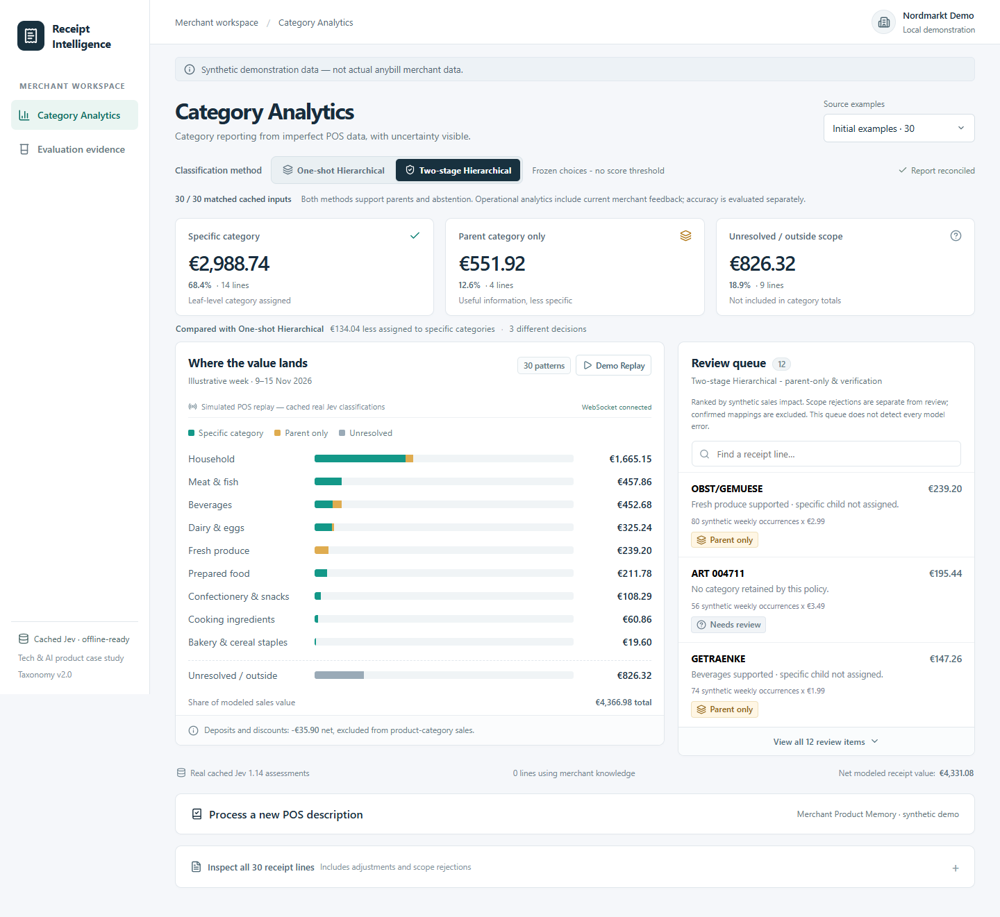

# Receipt Intelligence

**Category analytics from imperfect POS descriptions, with visible uncertainty and auditable merchant knowledge.**

A local B2B prototype for an anybill Tech & AI Product Internship case study. It connects real cached Jev classifications to a merchant-facing review workflow, persistent Product Memory and explainable reporting.

**Synthetic demonstration data only. No real anybill merchant data, production POS integration or connection to anybill infrastructure was used.**

## The problem

Purchase Intelligence depends on consistent product information, but POS descriptions can be abbreviated, incomplete or misleading. `HARIBO SAURE POMMES` is confectionery; `POMMES FRITES TK` is a prepared potato product. `MOLKEREI ART` supports a dairy parent without identifying a particular product.

Forcing every line into a precise category can hide errors in sales reports. This prototype retains useful parent-level information, exposes abstention and lets merchants correct decisions or reuse confirmed product knowledge. It demonstrates an extension to normalization and review workflows, not a replacement for production infrastructure.

## Dashboard



Captured from the verified local application in Two-stage Hierarchical mode. All amounts derive from stored synthetic occurrence assumptions; category assignment is not a claim of verified model accuracy.

## Key functionality

- **One-shot vs Two-stage Hierarchical:** replay frozen experiment D and TOPDOWN decisions over the same paired inputs.
- **Explicit uncertainty:** distinguish specific leaves, parent-only classifications, abstention, outside-scope routing and unavailable offline evidence.
- **Merchant Product Memory:** reuse guarded, merchant/POS-scoped identifiers and exact confirmed aliases.
- **Hybrid retrieval:** lexical matching and local multilingual embeddings suggest catalog candidates; similarity never establishes identity automatically.
- **Review and audit:** inspect cached distributions and hashes, confirm/reject suggested products, reverse alias mappings, or apply/undo exact-line category corrections.
- **Operational analytics:** one category visualization, three specificity metrics and a selected-method review queue ranked by synthetic sales impact. Deposits and discounts stay separate from product-category revenue.
- **Controlled replay:** real WebSocket notifications deliver simulated receipt events backed by cached classifications; REST remains authoritative and provides a fallback.

## Architecture and decision cascade

React + TypeScript + Vite communicate with FastAPI through REST and WebSockets. SQLite stores merchant feedback, product aliases and replay state. The frozen experiment files remain immutable evidence.

For each receipt line:

1. Apply an active **merchant correction for that exact receipt line**.
2. Otherwise reuse an applicable **confirmed merchant/POS identifier or exact alias**, subject to conflict checks.
3. Otherwise retrieve **untrusted catalog suggestions** and use the selected cached Jev method when an identical input exists. Without a cache, show **Needs verification**; no live model call is made.

The Inspector exposes **Receipt input → Product Memory → Jev assessment → Policy → Final outcome**. Confirmations persist across reloads and retain provenance and reversal history. Retrieved candidates are not sent to Jev; this is product retrieval and mapping reuse, not RAG.

## Frozen experimental findings

The evidence comprises **30 original and 24 additional synthetic German receipt lines**, taxonomy v2 with **10 parents and 27 leaves**, and real cached `typesafe/jev-1.14` responses collected through OpenRouter. The application makes no new Jev requests.

Both primary methods retain the frozen follow-up's **raw selected choices without thresholds**. D chooses among 27 leaves, 10 parent-only actions and two special options in one question. TOPDOWN first selects a parent, then a conditional child or `unspecified_child`. Wording, prompt lengths and score meanings differ; this is not a controlled topology-only comparison.

| Matched synthetic set | Method | Correct leaf | Correct parent | Category errors¹ | Abstentions | Scope correct / wrong | Category coverage |
|---|---|---:|---:|---:|---:|---:|---:|
| Original 30/30 | One-shot D | 19 | 4 | 1 | 5 | 1 / 0 | 24/30 |
| Original 30/30 | Two-stage TOPDOWN | 17 | 4 | 0 | 8 | 1 / 0 | 21/30 |
| Additional 24/24 | One-shot D | 12 | 1 | 2 | 6 | 2 / 1 | 15/24 |
| Additional 24/24 | Two-stage TOPDOWN | 11 | 3 | 1 | 7 | 2 / 0 | 15/24 |

¹ Includes overclaiming a specific child on a parent-only label. Scope errors are separate. Abstention is not a classification success; correct parents are not correct leaves. Category counts include receipt adjustments, whose value is excluded from product sales analytics. Unavailable pairs are excluded from both methods, never scored as errors or abstentions.

D was faster and TOPDOWN cheaper in the recorded runs, but original TOPDOWN timing is historical and D uses a longer prompt. Neither method is established as universally superior. Model scores are not calibrated correctness probabilities. The old **Naive Forced Baseline** and **SAFE 0.85 heuristic** are preserved in technical evaluation, not offered as merchant operating modes.

See the [frozen findings](results/taxonomy-v2/followup-D-vs-TOPDOWN/findings.md) and [methodology, costs and limitations](app/PRODUCT_QUALITY.md). Operational merchant feedback does not alter these evaluation results.

## Install and run

Requirements: **Python 3.12+** for the pinned dependencies and **Node.js 22.12+** with npm. The prepared workspace was verified with Python 3.13.3 and Node 26.13.1. Run these PowerShell commands from the repository root; create the virtual environment only on first setup:

```powershell
python -m venv .venv
.\.venv\Scripts\python.exe -m pip install -r app/backend/requirements-dev.txt
Push-Location app/frontend
npm ci
Pop-Location
```

Prepare the optional local semantic encoder once, while online (approximately 135 MB, pinned files and SHA-256 checks):

```powershell
.\.venv\Scripts\python.exe -B app/tools/prepare_embeddings.py
```

Without those files, the UI explicitly falls back to lexical-only suggestions. The actual cached Jev responses do not require credentials. Never commit `.env`.

Build and start the single-process offline demo:

```powershell
powershell -NoProfile -ExecutionPolicy Bypass -File app/build-frontend.ps1
powershell -NoProfile -ExecutionPolicy Bypass -File app/start-backend.ps1
```

Open **http://127.0.0.1:8000**; API docs are at **http://127.0.0.1:8000/docs**. Stop with Ctrl+C. For frontend development, start `app/start-frontend.ps1` in another terminal and open port **5173**. Dependency/model preparation needs internet; the prepared demo runs offline.

## Synthetic data and limitations

The 54 descriptions and proposed labels are assistant-authored synthetic development examples checked into the repository, not sampled merchant transactions or independent human-validated ground truth. Ambiguous lines retain parent-only or insufficient-information labels. No data-generation model calls are needed to run the application.

Weekly quantities are a separate stored ledger generated with seed **20261118**, without evaluation labels; all money uses integer cents. [The generator](app/tools/create_sales_assumptions.py) refuses to overwrite an existing ledger. The fictional merchant catalog and Product Memory review scenarios are separate synthetic demonstrations. Their earlier evaluation uses scripted oracle confirmations and historical SAFE at 0.85; it is not observed merchant acceptance, new Jev inference or measured production savings.

This small exploratory sample establishes neither production accuracy nor calibration or statistical significance. Raw leaf mistakes can escape the state-based review queue. Identity conflict rules are incomplete, merchant attestations can be wrong, and the application is a local single-worker prototype without authentication or live POS integration.

## Tests and verification

The quality sprint passed **49 backend tests**, TypeScript/Vite production build and both browser workflows: corrections/persistence/undo, Product Memory confirm/reuse/reverse, WebSocket replay, deduplication and REST fallback. Use a fresh project-local test directory:

```powershell
.\.venv\Scripts\python.exe -B -m pytest app/backend/tests -q -p no:cacheprovider --basetemp=app/.artifacts/submission-tests-01
```

Runtime databases, downloaded models, dependencies and test artifacts are ignored. The [original experiment README](docs/archive/jev-experiment-readme.md) is preserved byte-for-byte. The integrity verifier checks that archive against the manifest's unchanged original README hash, along with all other recorded artifacts:

```powershell
.\.venv\Scripts\python.exe -B app/tools/verify_integrity.py
```

Frozen evidence and its real timestamps remain unchanged. See the [provenance note](docs/PROVENANCE.md) for the exact hash and explicit archival path mapping.

## Further reading

- [Application setup, architecture and verification](app/README.md)
- [Product Memory, embeddings and synthetic evaluation](app/PRODUCT_MEMORY.md)
- [Method safeguards, actual results and the 2–3 minute demo](app/PRODUCT_QUALITY.md)
